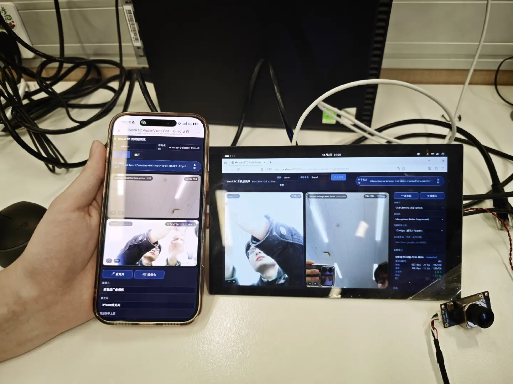

English | [中文](README_zh.md)

# WebRTC Video Call

A WebRTC video calling demo for the Quectel Pi M2.
The board is connected to a USB camera and a microphone; a phone opens a web page (by scanning a QR code)
and starts a two-way video call with the board.

The signaling server runs on the board itself (Python standard library, no third-party packages).
The phone gets a trusted HTTPS origin from a free Cloudflare tunnel; the media itself is peer-to-peer
and never passes through a server.

[](docs/assets/demo.jpg)

*Phone and the M2 board in a call, each showing local and remote video*

## Features

- Two-way call between the board and a phone / PC; VP8 / H.264 / Opus auto-negotiated
- Live statistics: bitrate, resolution, frame rate, packet loss, jitter, RTT, codec
- Camera / microphone switching, mute, camera off, video bitrate cap
- No app required — any modern browser works
- UI in Chinese or English, switchable at runtime and remembered per browser
- `start.sh` prints the phone URL and a QR code
- Built-in self-checks: signaling test, media-path self-test, capture probe, `/healthz` status API

Phone-side UI with live statistics:


| Item | Value |
|---|---|
| Board page | `http://localhost:8080/?room=demo&name=Board` |
| Phone page | `https://<random>.trycloudflare.com/?room=demo` printed by `start.sh` |
| PC on the same LAN | `https://<board-ip>:8443/?room=demo` |
| Room | `demo` by default, up to 4 peers |
| Media | peer-to-peer, RTT 1–5 ms on a LAN |

## Hardware Requirements

- Quectel Pi M2 (RK3576, Debian 13 factory image)
- USB camera (UVC)
- Microphone and speaker (camera-embedded or onboard)
- A phone or a PC with a browser
- Internet access on the board (for the tunnel)

## Software Environment

- OS: Debian 13 (M2 factory image)
- Python: 3.8+ (image ships 3.13), no third-party packages
- Browser on the board: Firefox (pre-installed)
- Installed by `install.sh`: `curl`, `openssl`, `v4l-utils`, `lsof`, `qrencode`, `firefox-esr`
- Downloaded by `install.sh`: `cloudflared`

### Implementation Steps

1. Clone the project.

```
sudo apt update
sudo apt install -y git
git clone https://github.com/Quectel-Pi/demo-webrtc-video-call.git
```

A `demo-webrtc-video-call` folder is created in the current directory.

2. Run these commands on the board. **Deployment is successful when the terminal shows `Deployment complete`.**

```
cd demo-webrtc-video-call
sudo chmod 755 install.sh
sudo bash install.sh
```

The script installs dependencies, downloads `cloudflared`, generates the local CA and certificates,
fixes the camera device node, and runs syntax checks.
If it fails or `Deployment complete` does not appear, check the network and re-run `sudo bash install.sh`
from the project root.

3. Start it.

```
bash start.sh
```

The terminal prints the phone URL and QR code, and opens the board browser in the same room.

## Project Structure

```
demo-webrtc-video-call/
├── docs/assets/                     # Documentation images
├── src/
│   ├── server.py                    # Signaling + static file server (stdlib)
│   ├── web/                         # Front end
│   │   ├── index.html
│   │   ├── app.js                   # WebRTC logic, device switching, stats
│   │   ├── style.css
│   │   ├── selftest.html            # Media-path self-test
│   │   └── probe.html               # Capture probe
│   ├── tools/
│   │   ├── camera_node.sh           # Camera node mapping
│   │   ├── make_cert.sh             # Local CA + server certificate
│   │   ├── open_browser.sh          # Launch the board browser
│   │   ├── tunnel.sh                # Cloudflare tunnel
│   │   ├── publish_url.sh           # Extract tunnel URL
│   │   ├── test_signaling.py        # Signaling self-test
│   │   ├── wsclient.py
│   │   └── edge_probe.py            # Debug helper
│   └── certs/                       # Generated at runtime
├── local/                           # Runtime: logs, pid, tunnel URL, QR code
├── install.sh
├── start.sh
├── stop.sh
├── setup_autostart.sh
├── requirements.txt
└── README.md / README_zh.md
```

## Run the program

### Board

```
bash start.sh                 # server + tunnel + board browser
bash start.sh --no-browser    # headless board
bash start.sh --no-tunnel     # LAN only
```

### Phone

1. Connect to the same network as the board
2. Scan the QR code or open the URL printed by `start.sh`
3. Tap “Join room” and allow camera / microphone
4. If the board's audio is silent, tap “Enable sound” on the page

### Stop / autostart

```
bash stop.sh
sudo bash setup_autostart.sh install [--with-kiosk]
sudo bash setup_autostart.sh uninstall
bash setup_autostart.sh status
```

The phone URL is written to `local/tunnel-url.txt`, the QR code to `local/qrcode.png`.

## Camera node

Browsers only enumerate `/dev/video0..63`. On RK3576 the platform nodes occupy 0–72 and a USB camera
usually lands on `/dev/video73`, so no videoinput is reported and `getUserMedia` fails with
`NotFoundError` (audio still works).

`camera_node.sh` repoints an unused debug node (default `/dev/video63`) at the real camera node.
`install.sh` runs it and installs `webrtc-camlink.service`. If the camera is already within 0–63 the
script skips.

```
bash src/tools/camera_node.sh --show
```

## Troubleshooting

| Symptom | Cause | Fix |
|---|---|---|
| Phone page keeps loading | Tunnel down or URL expired | `bash src/tools/tunnel.sh --url`; re-run `bash start.sh` |
| Phone sees no board picture | Camera not enumerated | `bash src/tools/camera_node.sh --check`, then `sudo bash src/tools/camera_node.sh` and reload |
| Picture but no sound on the phone | Possibly restricted by browser permissions | Try scanning the QR code with WeChat |
| `connected` but 0 kbps | Camera node held by another process | `lsof /dev/video63`, stop it, reload |
| Certificate warning | Using `https://<board-ip>:8443` | Use the tunnel URL, or accept once |
| “No internet, cannot create tunnel” | Board fell back to a network without internet | `nmcli device wifi connect "<ssid>" password "<pw>"` |
| `install.sh` download fails | Board has no internet | Download `cloudflared-linux-arm64` on a PC, `scp` to `/usr/local/bin/`, re-run |

## Self-check

```
python3 src/tools/test_signaling.py --port 8080   # 10 signaling assertions
# http://localhost:8080/selftest.html              # media-path self-test
# http://localhost:8080/probe.html                 # capture probe
curl -s http://localhost:8080/healthz              # live state of each client
```

## Measured (Quectel Pi M2 + iPhone)

| Direction | Resolution / fps | Bitrate |
|---|---|---|
| Board → phone | 1280x720 @ 20–30 fps | 1.0–1.6 Mbps |
| Phone → board | 720x1280 @ 30 fps | 1.5 Mbps |
| Audio | Opus 48 kHz | 30–60 kbps |

RTT 1–5 ms, 0 % packet loss.

## Reporting Issues

If you run into problems, post on the [Quectel official forum](https://forumschinese.quectel.com/c/quectel-pi/58).
Issues and pull requests are welcome.
