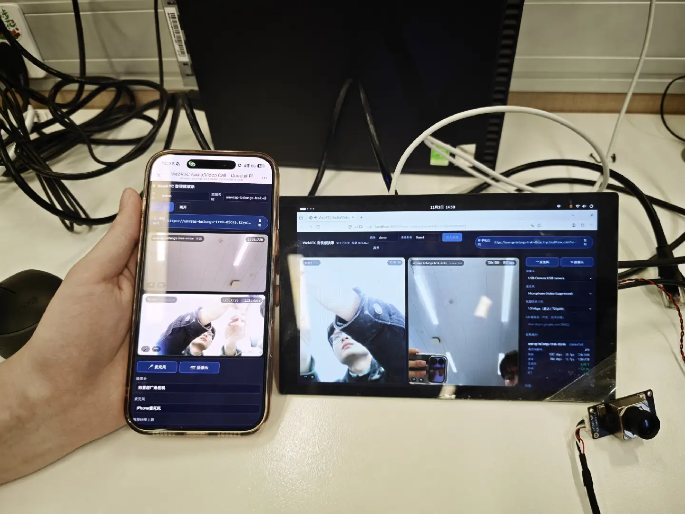

中文 | [English](README.md)

# WebRTC 音视频通话

本项目是基于Quectel Pi M2智能主控板上实现的 WebRTC 音视频通话示例。
板子接 USB 摄像头和扬声器，手机扫码打开网页就能和板子双向视频通话。

信令服务跑在板子上（Python 标准库，无第三方依赖），手机通过 Cloudflare 免费隧道拿到受信任的
HTTPS 地址；音视频是 P2P 直连，不经过服务器。

[](docs/assets/demo.jpg)

*手机与 M2 板子通话，两端同时显示本地和对方画面*

## 功能

- 板子 ↔ 手机 / PC 双向音视频通话，VP8 / H.264 / Opus 自动协商
- 实时统计：码率、分辨率、帧率、丢包、抖动、RTT、编解码器
- 摄像头 / 麦克风切换、静音、关闭摄像头、视频码率上限
- 网页免安装，手机和 PC 用浏览器打开即可
- `start.sh` 自动打印手机访问地址和二维码
- 内置自检：信令自检、通路自检、采集探针、`/healthz` 状态接口

手机端界面（含实时统计）：

| 项目 | 说明 |
|---|---|
| 板端页面 | `http://localhost:8080/?room=demo&name=Board` |
| 手机页面 | `start.sh` 打印的 `https://<随机>.trycloudflare.com/?room=demo` |
| 局域网 PC | `https://<板子IP>:8443/?room=demo` |
| 房间 | 默认 `demo`，最多 4 路 |
| 媒体 | P2P，局域网内 RTT 1~5 ms |

## 硬件要求

- Quectel Pi M2 单板计算机（RK3576，Debian 13 出厂镜像）
- USB 摄像头（UVC）
- 麦克风和扬声器（USB 摄像头自带麦克风或板载麦克风）
- 手机或PC
- 板子能访问外网（用于建立隧道）

## 软件环境

- 操作系统：Debian 13（M2 出厂镜像）
- Python：3.8+（镜像自带 3.13），无第三方包
- 板端浏览器：Firefox（镜像自带）
- `install.sh` 自动安装：`curl`、`openssl`、`v4l-utils`、`lsof`、`qrencode`、`firefox-esr`
- `install.sh` 自动下载：`cloudflared`

### 部署步骤

1. 克隆项目。

```
sudo apt update
sudo apt install -y git
git clone https://github.com/Quectel-Pi/demo-webrtc-av-call.git（待定）
```

当前目录会生成 `demo-webrtc-av-call` 文件夹。

2. 在板子终端依次执行。**终端显示 `Deployment complete` 即部署成功。**

```
cd demo-webrtc-av-call
sudo chmod 755 install.sh
sudo bash install.sh
```

脚本会安装依赖、下载 `cloudflared`、生成本地 CA 和证书、修复摄像头节点，最后做语法自检。
如果报错或没有出现 `Deployment complete`，确认网络正常后在项目根目录重新执行 `sudo bash install.sh`。

3. 启动。

```
bash start.sh
```

终端打印手机访问地址和二维码，并打开板端浏览器加入房间。

## 项目结构

```
demo-webrtc-av-call/
├── docs/assets/                     # 文档图片
├── src/
│   ├── server.py                    # 信令 + 静态文件服务（标准库）
│   ├── web/                         # 前端
│   │   ├── index.html
│   │   ├── app.js                   # WebRTC 逻辑、设备切换、统计面板
│   │   ├── style.css
│   │   ├── selftest.html            # 通路自检
│   │   └── probe.html               # 采集探针
│   ├── tools/
│   │   ├── camera_node.sh           # 摄像头节点映射
│   │   ├── make_cert.sh             # 本地 CA + 证书
│   │   ├── open_browser.sh          # 打开板端浏览器
│   │   ├── tunnel.sh                # Cloudflare 隧道
│   │   ├── publish_url.sh           # 提取隧道地址
│   │   ├── test_signaling.py        # 信令自检
│   │   ├── wsclient.py
│   │   └── edge_probe.py            # 调试用
│   └── certs/                       # 运行时生成
├── local/                           # 运行时目录：日志、pid、隧道地址、二维码
├── install.sh
├── start.sh
├── stop.sh
├── setup_autostart.sh
├── requirements.txt
└── README.md / README_zh.md
```

## 运行

### 板子

```
bash start.sh                 # 启动服务和隧道，打开板端浏览器
bash start.sh --no-browser    # 没有桌面时
bash start.sh --no-tunnel     # 只在局域网使用
```

### 手机

1. 连上与板子相同的网络
2. 扫码或输入 `start.sh` 打印的地址
3. 点「加入房间」，允许摄像头和麦克风
4. 听不到板子声音时，点页面上的「开启声音」

### 停止 / 自启

```
bash stop.sh
sudo bash setup_autostart.sh install [--with-kiosk]
sudo bash setup_autostart.sh uninstall
bash setup_autostart.sh status
```

自启后手机地址写入 `local/tunnel-url.txt`，二维码在 `local/qrcode.png`。

## 摄像头节点

浏览器采集只枚举 `/dev/video0..63`。RK3576 的平台节点占满 0~72，USB 摄像头常在
`/dev/video73`，此时浏览器拿不到 videoinput，`getUserMedia` 报 `NotFoundError`（音频正常）。

`camera_node.sh` 把一个空闲调试节点（默认 `/dev/video63`）改成指向真实相机节点，
`install.sh` 已执行过并装了 `webrtc-camlink.service`。相机本来就在 0~63 时脚本自动跳过。

```
bash src/tools/camera_node.sh --show
```

## 故障排查

| 现象 | 原因 | 处理 |
|---|---|---|
| 手机页面一直加载 | 隧道没起来或地址已失效 | `bash src/tools/tunnel.sh --url`，重跑 `bash start.sh` |
| 手机看不到板子画面 | 摄像头没被浏览器识别 | `bash src/tools/camera_node.sh --check`，必要时 `sudo bash src/tools/camera_node.sh` 后重开页面 |
| 手机有画面没声音 | iOS 禁止带声音的自动播放 | 点页面上的「开启声音」 |
| 连接成功但码率 0 | 相机被其他进程占用 | `lsof /dev/video63` 查占用，停掉后重开页面 |
| 证书警告 | 用的是 `https://<板子IP>:8443` | 改用隧道地址，或接受一次警告 |
| 提示没有外网，无法建立隧道 | 板子连到了没有外网的热点（如公司访客网） | `nmcli device wifi connect "<热点>" password "<密码>"` |
| `install.sh` 下载失败 | 板子无外网 | 在 PC 下载 `cloudflared-linux-arm64`，`scp` 到 `/usr/local/bin/` 后重跑 |

## 自检

```
python3 src/tools/test_signaling.py --port 8080   # 信令 10 项断言
# http://localhost:8080/selftest.html              # 通路自检
# http://localhost:8080/probe.html                 # 采集探针
curl -s http://localhost:8080/healthz              # 各端实时状态
```

## 实测（Quectel Pi M2 + iPhone）

| 方向 | 分辨率 / 帧率 | 码率 |
|---|---|---|
| 板子 → 手机 | 1280x720 @ 20~30 fps | 1.0~1.6 Mbps |
| 手机 → 板子 | 720x1280 @ 30 fps | 1.5 Mbps |
| 音频 | Opus 48 kHz | 30~60 kbps |

RTT 1~5 ms，丢包 0%。

## 参考资料

接口和协商流程按 W3C 规范与 webrtc.org 文档实现，代码为本项目自研，未复制 webrtc.org 示例仓库的源码。

- W3C WebRTC 规范（`RTCPeerConnection` / `getUserMedia` / `getStats`）：https://w3c.github.io/webrtc-pc/
- 应用流程概览：https://webrtc.org/getting-started/overview
- Peer connection 与信令：https://webrtc.org/getting-started/peer-connections
- 媒体设备：https://webrtc.org/getting-started/media-devices
- 官方示例（BSD-3-Clause，仅供对照）：https://webrtc.github.io/samples

## 报告问题

使用中遇到问题，可在 [Quectel 官方论坛](https://forumschinese.quectel.com/c/quectel-pi/58) 提交技术咨询，
也可提交 Issue 或 Pull Request。
